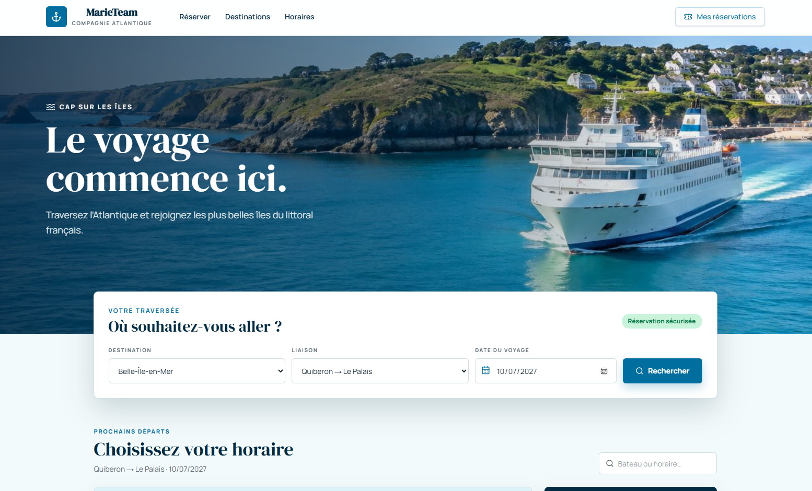
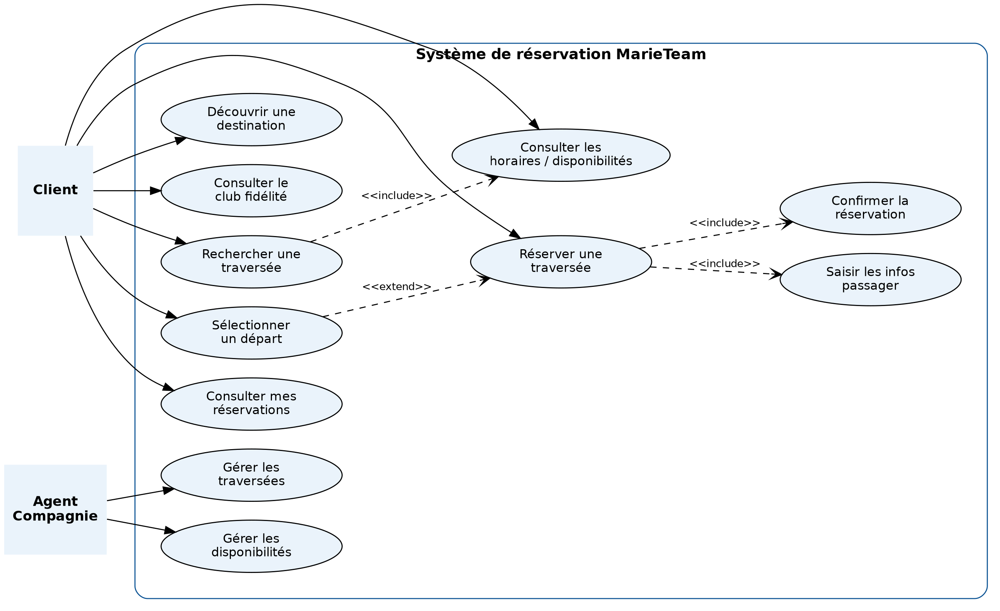
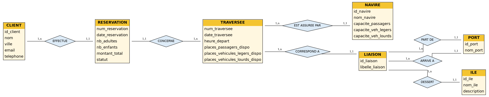
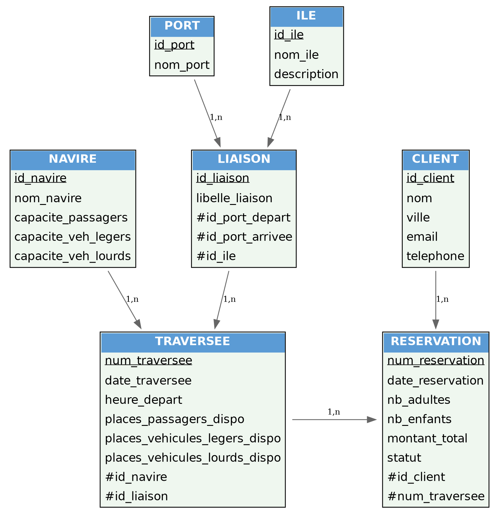

# MarieTeam

**Système de réservation de traversées marieteam vers les îles du littoral français**

  

> MarieTeam est une plateforme (fictive) de réservation en ligne de traversées vers Belle-Île-en-Mer, Ouessant, l'île de Groix, etc. Le client recherche une liaison, consulte les horaires et les places restantes, puis réserve pour des passagers et des véhicules.



---

##  Sommaire

1. [Contexte et objectifs](#-contexte-et-objectifs)
2. [Fonctionnalités](#-fonctionnalités)
3. [Analyse : cas d'utilisation](#-analyse--cas-dutilisation)
4. [Modélisation des données](#-modélisation-des-données)
5. [Charte graphique](#-charte-graphique)
6. [Maquettes](#-maquettes)
7. [Technologies utilisées](#-technologies-utilisées)
8. [Planning et organisation](#-planning-et-organisation)
9. [Installation](#-installation)
10. [Équipe](#-équipe)

---

##  Contexte et objectifs

**Contexte :** MarieTeam est une compagnie maritime fictive qui relie le continent aux îles du littoral français. Elle souhaite proposer un site web simple pour consulter les traversées et réserver en ligne, sans passer par le guichet ou le téléphone.

**Besoins :**
- **Client :** rechercher une traversée (destination, liaison, date), consulter horaires et places restantes, réserver pour des passagers et des véhicules, retrouver ses réservations, découvrir les destinations, consulter le club fidélité.
- **Agent de la compagnie :** gérer les traversées et les disponibilités.

**Contraintes :**
- projet réalisé en équipe, en temps limité (3 semaines) ;
- charte graphique cohérente sur toutes les pages ;
- choix technologiques justifiés ;
- travail collaboratif via GitHub ;
- présentation orale devant un jury.

---

## Fonctionnalités

###  Client
-  Rechercher une traversée (destination, liaison, date)
-  Consulter les horaires et les disponibilités (passagers, véhicules)
-  Sélectionner un départ
-  Réserver une traversée (saisie des infos passager, confirmation, montant total, numéro de réservation)
-  Consulter ses réservations
-  Découvrir les destinations (Belle-Île, Ouessant, Groix…)
-  Consulter le club fidélité

###  Agent de la compagnie
-  Gérer les traversées (horaires, navire, liaison)
-  Gérer les disponibilités (passagers, véhicules légers, véhicules lourds)

---

##  Analyse : cas d'utilisation

Deux acteurs : le **Client** et l'**Agent compagnie**.



| Cas d'utilisation | Acteur | Description |
|---|---|---|
| Rechercher une traversée | Client | Choix d'une destination, d'une liaison et d'une date |
| Consulter horaires / disponibilités | Client | Liste des départs avec horaires, navire et places restantes |
| Sélectionner un départ | Client | Choix d'un créneau précis |
| Réserver une traversée | Client | Initie la réservation du départ sélectionné |
| Saisir les infos passager | Client | Nom, ville, nombre d'adultes et d'enfants *(inclus dans « Réserver »)* |
| Confirmer la réservation | Client | Validation, calcul du montant, numéro de réservation *(inclus dans « Réserver »)* |
| Consulter mes réservations | Client | Liste des réservations existantes |
| Découvrir une destination | Client | Fiches des îles desservies |
| Consulter le club fidélité | Client | Points de fidélité et avantages |
| Gérer les traversées | Agent | Création, modification, suppression |
| Gérer les disponibilités | Agent | Mise à jour des places par traversée |

---

##  Modélisation des données

### Dictionnaire de données (résumé)

7 entités :

| Entité | Champs principaux |
|---|---|
| **CLIENT** | `id_client`, `nom`, `ville`, `email` (unique), `telephone` |
| **RESERVATION** | `num_reservation`, `date_reservation`, `nb_adultes`, `nb_enfants`, `montant_total`, `statut`, `#id_client`, `#num_traversee` |
| **TRAVERSEE** | `num_traversee`, `date_traversee`, `heure_depart`, `places_passagers_dispo`, `places_vehicules_legers_dispo` (≤ 2 m), `places_vehicules_lourds_dispo` (> 2 m), `#id_navire`, `#id_liaison` |
| **NAVIRE** | `id_navire`, `nom_navire`, `capacite_passagers`, `capacite_veh_legers`, `capacite_veh_lourds` |
| **LIAISON** | `id_liaison`, `libelle_liaison`, `#id_port_depart`, `#id_port_arrivee`, `#id_ile` |
| **PORT** | `id_port`, `nom_port` |
| **ILE** | `id_ile`, `nom_ile`, `description` |

Le statut d'une réservation peut être : *en attente*, *confirmée* ou *annulée*.

### MCD (Merise)



**Règles de gestion :**
- Un client effectue une ou plusieurs réservations ; une réservation est effectuée par un seul client.
- Une réservation concerne une seule traversée ; une traversée peut avoir plusieurs réservations.
- Une traversée est assurée par un seul navire ; un navire peut assurer plusieurs traversées.
- Une traversée correspond à une seule liaison ; une liaison peut donner lieu à plusieurs traversées.
- Une liaison part d'un seul port et arrive à un seul port ; un port peut être départ ou arrivée de plusieurs liaisons.
- Une liaison dessert une seule île ; une île peut être desservie par plusieurs liaisons.

### MLD



Les clés primaires sont soulignées, les clés étrangères sont précédées de `#`.

```text
CLIENT      (id_client, nom, ville, email, telephone)
NAVIRE      (id_navire, nom_navire, capacite_passagers, capacite_veh_legers, capacite_veh_lourds)
PORT        (id_port, nom_port)
ILE         (id_ile, nom_ile, description)
LIAISON     (id_liaison, libelle_liaison, #id_port_depart, #id_port_arrivee, #id_ile)
TRAVERSEE   (num_traversee, date_traversee, heure_depart, places_passagers_dispo,
             places_vehicules_legers_dispo, places_vehicules_lourds_dispo, #id_navire, #id_liaison)
RESERVATION (num_reservation, date_reservation, nb_adultes, nb_enfants, montant_total,
             statut, #id_client, #num_traversee)
```

---

##  Charte graphique

### Palette

| Rôle | Couleur | Code | Usage |
|---|---|---|---|
| Primaire | Bleu océan / pétrole | `#006A9B` | Logo, bouton « Rechercher », liens |
| Profondeur | Bleu marine foncé | `#022B45` | Carte « Votre sélection », pied de page, titres |
| Fonds | Bleu glacé / bleu clair | `#F0F9FB` · `#DDF1F7` | Fond de page, bandeaux |
| Action | Corail | `#E8664A` | Bouton « Réserver ce départ » |
| Promo | Jaune soleil | `#FFCE5C` | Carte « Club fidélité » |
| Statuts | Vert, orange, rouge pastel | - | Disponibilité des places (disponibles, limitées, complet) |

### Typographie
- **Titres, heures, marque :** serif à fort contraste (type Fraunces / DM Serif Display)
- **Texte, tableaux, boutons :** sans-serif géométrique sobre
- **Surtitres :** petites capitales espacées en bleu primaire

### Logo
Carré bleu primaire arrondi avec une ancre blanche, « MarieTeam » en serif gras et « COMPAGNIE ATLANTIQUE » en petites capitales.

### Composants et style
- Cartes blanches, ombres douces, angles légèrement arrondis (4 à 8 px)
- Formulaire de recherche chevauchant le bas du hero
- Tableau d'horaires aéré, ligne sélectionnée surlignée en bleu clair
- Pastilles colorées pour les places passagers et véhicules
- Boutons principaux pleins, boutons secondaires en contour
- Contenu centré (~1000 px), beaucoup d'espace blanc, ton chaleureux et voyageur

---

##  Maquettes

Pages principales : accueil avec formulaire de recherche, tableau des horaires avec bloc « Votre sélection », club fidélité, espace gestionnaire.


<!-- TODO : ajouter les captures du tableau des horaires, du club fidélité et de l'espace gestionnaire -->

---

## 🛠️ Technologies utilisées

| Technologie | Utilisation dans le projet |
|---|---|
| **Astro** | Structure et développement des pages du site |
| **Tailwind CSS** | Mise en forme et responsive design |
| **JavaScript** | Interactions côté client, contrôle des formulaires |
| **PHP** | Traitement des formulaires, communication avec la base de données |
| **C# / ASP.NET MVC** | Développement de l'application web, architecture MVC |
| **MySQL / PostgreSQL** | Gestion et stockage des données |
| **SQL** | Création et interrogation de la base de données |
| **Visual Studio** | Environnement de développement |
| **GitHub** | Gestion de projet en groupe |
| **Navigateur web** | Tests de l'application |
| **Lucid.app** | Diagrammes (cas d'utilisation, MCD, MLD) |

---

##  Planning et organisation

Travail réparti sur 3 semaines.

### Semaine 1 : Analyse et design
| Tâche | Responsable | Statut |
|---|---|---|
| Dépôt GitHub + planning | Les 2 | ✅ Fait |
| Déclaration textuelle | Oumaima | ✅ Fait |
| Diagramme de cas d'utilisation | Oumaima | ✅ Fait |
| MCD | Adel | ✅ Fait |
| Dictionnaire de données | Adel | ✅ Fait |
| MLD | Adel | ✅ Fait |
| Charte graphique + maquettes | Oumaima | ✅ Fait |

### Semaine 2 : Développement du site
| Tâche | Responsable | Statut |
|---|---|---|
| Arborescence + structure commune (en-tête, menu, pied de page) | Oumaima | ✅ Fait |
| Page d'accueil (bannière, slogan, formulaire de recherche) | Adel | ✅ Fait |
| Tableau des horaires + bloc « Votre sélection » + bouton Réserver | Oumaima | ✅ Fait |
| Espace gestionnaire (connexion + consultation) | Oumaima | ✅ Fait |
| Club fidélité + « Les îles vous attendent » + appel à l'action + pied de page | Adel | ✅ Fait |

### Semaine 3 : Documentation et finalisation
| Tâche | Responsable | Statut |
|---|---|---|
| Support de présentation + charte graphique à jour | Adel | ✅ Fait |
| Choix technologiques + plan du site | Les 2 | ✅ Fait |
| Corrections + dernier push GitHub | Oumaima | ✅ Fait |
| Répétition n°1 chronométrée (présentation + démo) | Les 2 | ✅ Fait |
| Répétition n°2 + préparation des questions du jury | Les 2 | ✅ Fait |

### Outils collaboratifs
- **GitHub :** dépôt commun, historique des commits, partage du code et des documents
- **Lucid.app :** diagramme de cas d'utilisation, MCD et MLD

---

##  Installation

> ⚠️ Section à compléter selon la stack finale retenue (Astro, PHP ou ASP.NET MVC, base MySQL ou PostgreSQL).

```bash
# 1. Cloner le dépôt
git clone https://github.com/<utilisateur>/<depot>.git
cd <depot>

# 2. Installer les dépendances
# ...

# 3. Créer la base de données (scripts SQL)
# ...

# 4. Lancer le projet
# ...
```

---

##  Équipe

| Nom | Rôle |
|---|---|
| **Oumaima** | Analyse, design, développement |
| **Adel** | Modélisation des données, développement |

---

<p align="center">Projet réalisé dans un cadre pédagogique · MarieTeam est une compagnie fictive ⚓</p>

[Exemplaires de sites pour se baser en développement sur ](https://mairie-team.lovable.app/)

##  Documents

-  [Présentation PowerPoint](docs/MarieTeam-dossierd'analyse.pptx)
-  [Dossier d'analyse (Word)](docs/MarieTeam_Analyse_corrige(1).docx)

